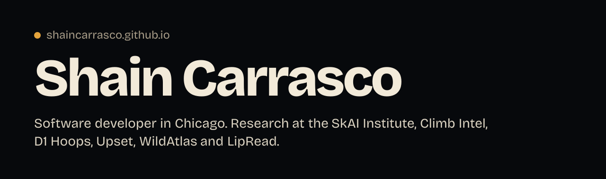
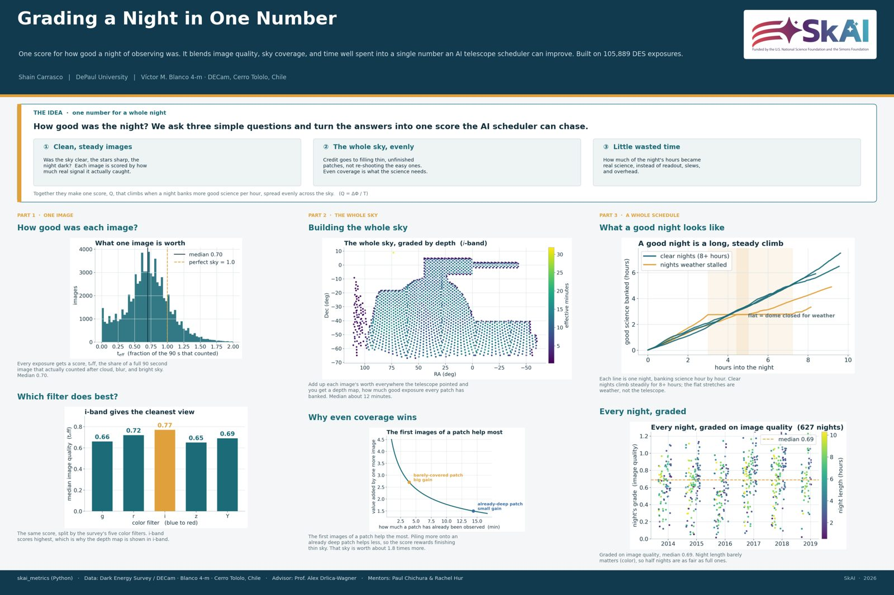

<!-- banner:start -->

<!-- banner:end -->

I build machine-learning products people use, research tools for astronomy, and Roblox games. Everything is on **[shaincarrasco.github.io](https://shaincarrasco.github.io)**, with the number each project was measured on.

### Summer 2026 at the SkAI Institute

I built a single score for how good a night of telescope observing was, so an AI scheduler can be trained and judged, and calibrated it on 74,323 survey exposures from the Dark Energy Survey's 105,889-exposure log, taken at Cerro Tololo, Chile, between 2013 and 2019. My effective exposure time matches the survey pipeline's own with a log-correlation of 0.952. Advised by Prof. Alex Drlica-Wagner, with Paul Chichura and Rachel Hur.

[Write-up](https://shaincarrasco.github.io/projects/skai-metrics/) · [full report](https://shaincarrasco.github.io/skai/report/) · [dashboard](https://shaincarrasco.github.io/skai/dashboard/) · [working note](https://shaincarrasco.github.io/skai/working-note-v0.1.pdf) · [poster PDF](https://shaincarrasco.github.io/skai/poster.pdf)

### Selected work

<!-- work:start -->
| Project | What it is |
| --- | --- |
| **[Climb Intel](https://climbintel.com)** · [case study](https://shaincarrasco.github.io/projects/climb-intel/) | Grades Kilter Board routes and predicts how hard a climb will feel for your body. Video coaching from phone clips. 72.8% of held-out climbs graded within one V-grade. |
| **[D1 Hoops](https://shaincarrasco.github.io/D1-Basketball-Analytics/)** · [case study](https://shaincarrasco.github.io/projects/d1-hoops/) · [code](https://github.com/shaincarrasco/D1-Basketball-Analytics) | Power ratings and game predictions for all 365 D-I basketball teams, graded in public every day. The same chart engine runs tennis, soccer and football. 78.3% of 568 out-of-sample game picks right this season (walk-forward backtest). |
| **[Upset](https://shaincarrasco.github.io/matchup/)** · [case study](https://shaincarrasco.github.io/projects/upset/) · [code](https://github.com/shaincarrasco/matchup) | Every fantasy matchup in your league as a live win probability, priced 1¢ to 99¢. Play coins only. |
| **[WildAtlas](https://wildatlas-three.vercel.app)** · [case study](https://shaincarrasco.github.io/projects/wildatlas/) | A 3D globe of life on Earth: biomes, species, and findings mined from research papers. Record what you see. |
| **[LipRead](https://shaincarrasco.github.io/lipread/)** · [case study](https://shaincarrasco.github.io/projects/lipread/) · [code](https://github.com/shaincarrasco/lipread) | Read the lips in a sports clip, on your phone, with nothing uploaded. |
| **[HoopLab](https://shaincarrasco.github.io/projects/hooplab/)** | Free college basketball analytics: team and player ratings from play-by-play, with its own predictions graded in public. |
| **[Roblox games](https://www.roblox.com/games/92465829726635)** · [case study](https://shaincarrasco.github.io/projects/roblox-games/) | Be a Stone, published on Roblox, and Scrap City, an urban survival game in development. 13 worlds in Be a Stone, each generated by a build script. |
| **[dowse, tripwire, catchup](https://shaincarrasco.github.io/tools/)** | Dependency-free tools: vault search for my agents, a secret scanner, a scheduler for a laptop that sleeps. 139 of 139 planted secrets found, 0 false alarms. |
<!-- work:end -->

Private repositories show the product and the measurements on the site; ask me for the code. This table and the banner are generated from the site, so they stay in step with it.

### This year

<!-- activity:start -->
**441 contributions in the last year.**
<!-- activity:end -->

Python, TypeScript, Go and Luau. pandas, scikit-learn, XGBoost, PyTorch, astropy. Flask, Next.js, Astro. PostgreSQL and Neon.
