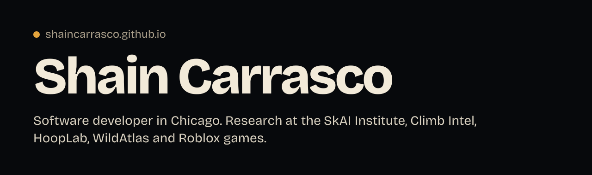
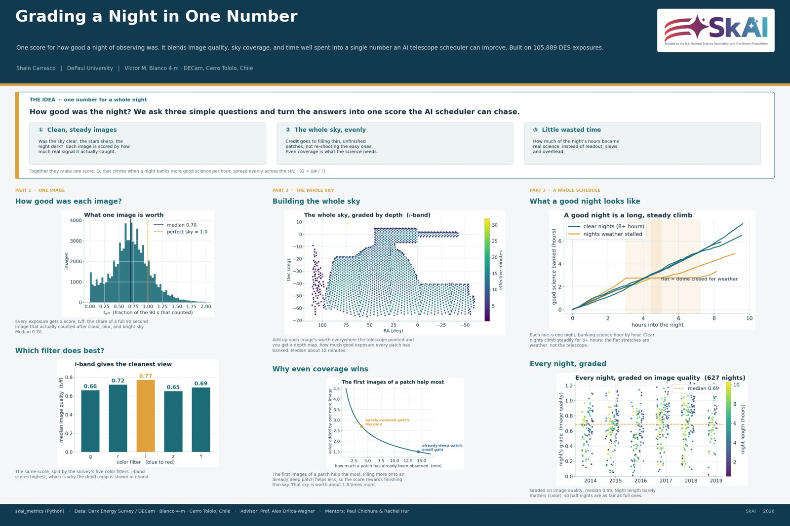

I build machine-learning products people use, research tools for astronomy, and Roblox games. Everything is on **[shaincarrasco.github.io](https://shaincarrasco.github.io)**, with the number each project was measured on.

### Summer 2026 at the SkAI Institute

I built a single score for how good a night of telescope observing was, so an AI scheduler can be trained and judged, and calibrated it on 74,323 survey exposures from the Dark Energy Survey's 105,889-exposure log, taken at Cerro Tololo, Chile, between 2013 and 2019. My effective exposure time matches the survey pipeline's own with a log-correlation of 0.952. Advised by Prof. Alex Drlica-Wagner, with Paul Chichura and Rachel Hur.

[Write-up](https://shaincarrasco.github.io/projects/skai-metrics/) · [full report](https://shaincarrasco.github.io/skai/report/) · [dashboard](https://shaincarrasco.github.io/skai/dashboard/) · [working note](https://shaincarrasco.github.io/skai/working-note-v0.1.pdf) · [poster PDF](https://shaincarrasco.github.io/skai/poster.pdf)

### Selected work

| Project | What it is |
| --- | --- |
| **[Climb Intel](https://climbintel.com)** | Grades Kilter Board routes and predicts how hard a climb will feel for your body. Live, with paid subscriptions. 72.8% of held-out climbs within one V-grade; 29,000 unique visitors in 30 days. |
| **[Upset](https://shaincarrasco.github.io/matchup/)** · [code](https://github.com/shaincarrasco/matchup) | Every fantasy matchup in your league as a live win probability. Play coins only. |
| **[HoopLab](https://shaincarrasco.github.io/projects/hooplab/)** | Free college basketball analytics, with its own predictions graded in public. Launching for the 2026–27 season. |
| **[WildAtlas](https://wildatlas-three.vercel.app)** | A 3D globe of life on Earth: biomes, species, findings mined from papers. |
| **[LipRead](https://shaincarrasco.github.io/lipread/)** · [code](https://github.com/shaincarrasco/lipread) | Reads the lips in a sports clip, on your phone, with nothing uploaded. Pre-release. |
| **[Be a Stone](https://www.roblox.com/games/92465829726635)** | A Roblox incremental simulator I built with Trip under Plymouth Experiences. Published September 2026: 13 worlds generated by build scripts, ghost races, and a paid membership. |
| **[dowse, tripwire, catchup](https://shaincarrasco.github.io/tools/)** | Dependency-free tools: vault search for my agents, a secret scanner, a scheduler for a laptop that sleeps. 139 of 139 planted secrets found, 0 false alarms. |

Private repositories show the product and the measurements on the site; ask me for the code.

### This year

<!-- activity:start -->
**294 contributions in the last year.**
<!-- activity:end -->

Python, TypeScript, Go and Luau. pandas, scikit-learn, XGBoost, PyTorch, astropy. Flask, Next.js, Astro. PostgreSQL and Neon.
